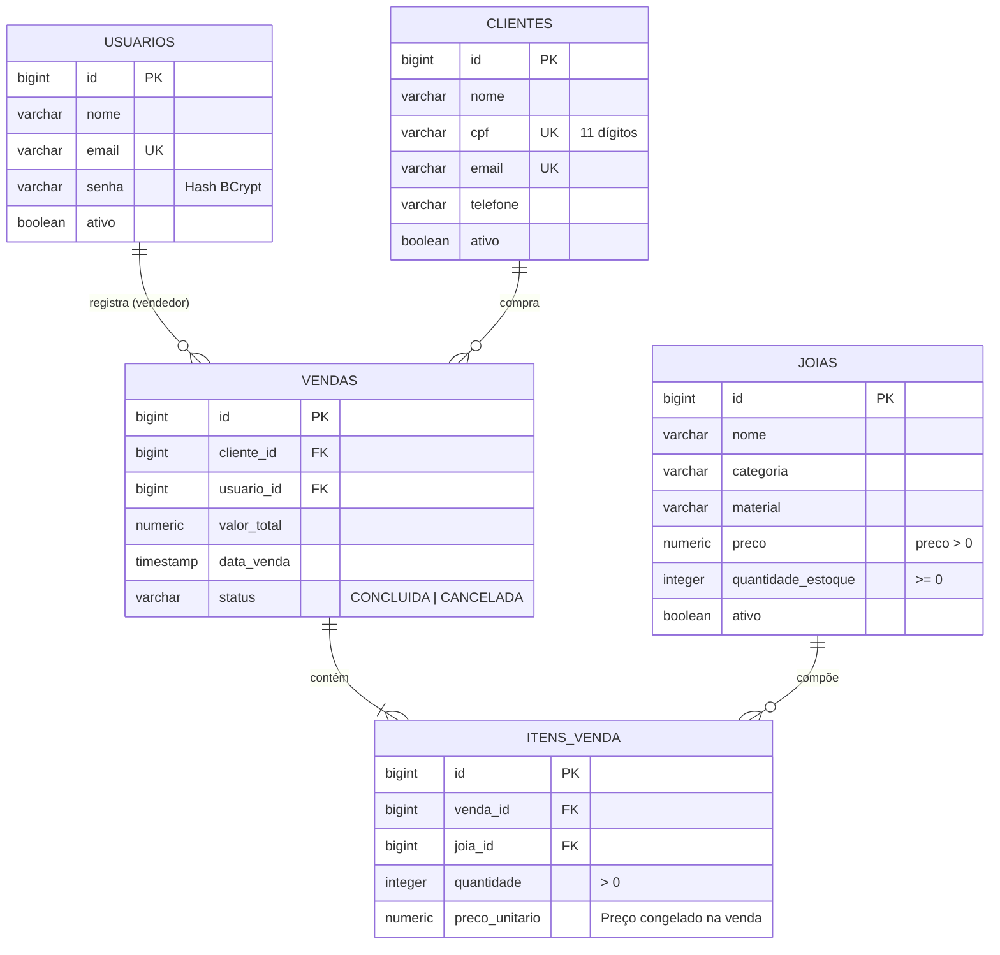

# L&P Joias — Sistema de Gestão e Vendas de Joalheria

**Disciplina:** Testes de Software | Projeto N2  
**Professor:** Reinaldo de Souza Junior  
**Integrantes:** Layane Lino e Pedro Moreira  

> **Vídeo de Apresentação do Sistema e Execução dos Testes:** [Assistir no YouTube (https://youtu.be/nqep0PnvtP4)](https://youtu.be/nqep0PnvtP4) | Pasta: [`/video`](video/README.md)

---

## 1. Proposta e Visão Geral do Sistema

O **L&P Joias** é um sistema web local de alta performance desenvolvido para gerenciar as operações de balcão e retaguarda de uma joalheria física. O sistema foi concebido com foco na experiência do usuário (UI/UX limpa, moderna e responsiva com suporte a modo claro/escuro), integridade transacional e **testabilidade automatizada** em todas as camadas da pirâmide de testes.

### Principais Funcionalidades e Políticas de Negócio
- **Autenticação Stateless (JWT + BCrypt):** Controle de acesso de operadores/funcionários com bloqueio imediato (`HTTP 403`) para usuários inativos;
- **Catálogo e Estoque de Joias:** Controle por categoria, material, preço positivo e saldo físico em loja;
- **Gestão Cadastral de Clientes:** Validação e normalização de CPF (11 dígitos únicos) e dados de contato;
- **Frente de Caixa (PDV):** Cálculo dinâmico de totais, congelamento de preço unitário histórico e validação atômica de disponibilidade de estoque;
- **Histórico de Vendas:** Consulta detalhada de cupons, edição transacional e cancelamento com estorno automático de peças ao estoque;
- **Políticas de Integridade Referencial e Fiscal:**
  - **Exclusão Lógica (*Soft Delete*):** Usuários, clientes e vendas nunca sofrem exclusão física do banco de dados;
  - **Exclusão Condicional de Joias:** Joias sem histórico de vendas são excluídas fisicamente (`deleted: true`); joias que já participaram de vendas são apenas inativadas (`inactivated: true`) e têm seus dados cadastrais protegidos contra alteração (`HTTP 409 Conflict`), permitindo apenas reposição de estoque;
  - **Proteção de Auto-inativação:** O operador autenticado é impedido de inativar o próprio registro (`HTTP 409 Conflict`).

---

## 2. Arquitetura e Estrutura do Repositório

```
lp-joias/                                # Raiz do repositório
├── README.md                            # Documentação unificada (Front-End + Back-End + Banco + Testes)
├── video/                               # Vídeo de apresentação do sistema e execução da suíte de testes
│   └── README.md                        # Link direto e player/miniatura da apresentação no YouTube
├── docs/                                # Especificação de requisitos (ERS) e edital da disciplina
│   ├── Avaliação N2.pdf
│   └── Escopo_Joalheria.md
├── front/                               # Front-End SPA (React 19 + TypeScript + Vite + Tailwind CSS)
│   ├── src/
│   │   ├── components/                  # Navbar, AppLayout, Modal e ToastNotification
│   │   ├── contexts/                    # AuthContext (JWT) e ThemeContext (Light/Dark)
│   │   ├── pages/                       # Login, PDV, Vendas, Joias, Clientes e Usuarios
│   │   ├── routes/                      # AppRoutes e guarda de rotas PrivateRoute
│   │   ├── services/                    # Cliente Axios (api.ts) e Serviços REST
│   │   ├── types/                       # Interfaces e contratos TypeScript
│   │   └── utils/                       # Formatadores de moeda (BRL), CPF, telefone e data/hora
│   ├── vite.config.ts                   # Proxy reverso /api -> http://localhost:8080
│   └── package.json
└── back/                                # Back-End REST API (Java 21 + Spring Boot 3.4 + PostgreSQL)
    ├── database/
    │   └── lp_joias_postgres.sql        # Script DDL PostgreSQL pronto para execução no DBeaver
    ├── src/
    │   ├── main/java/com/lpjoias/joalheria/
    │   │   ├── config/                  # SecurityConfig, OpenApiConfig (Swagger), DataSeeder
    │   │   ├── security/                # JwtService, JwtAuthenticationFilter, UserPrincipal
    │   │   ├── domain/                  # Entidades JPA (Usuario, Cliente, Joia, Venda, ItemVenda) e Enums
    │   │   ├── repository/              # Interfaces Spring Data JPA + EntityGraph
    │   │   ├── dto/                     # Java Records (contratos de entrada e saída isolados)
    │   │   ├── service/                 # Regras de negócio, transações atômicas (@Transactional) e validações
    │   │   ├── controller/              # Endpoints REST (/api/auth, /usuarios, /clientes, /joias, /vendas)
    │   │   └── exception/               # Exceções semânticas e GlobalExceptionHandler (JSON padronizado)
    │   └── test/java/com/lpjoias/joalheria/
    │       ├── unit/                    # Testes Unitários com JUnit 5 + Mockito (12 testes)
    │       ├── api/                     # Testes de Integração de API com REST-assured (5 testes)
    │       └── e2e/                     # Testes End-to-End com Selenium WebDriver (3 testes)
    ├── mvnw / mvnw.cmd                  # Maven Wrapper embutido (dispensa instalação global do Maven)
    └── pom.xml
```

---

## 3. Tecnologias Utilizadas

| Camada / Recurso | Tecnologia | Justificativa Técnica |
| :--- | :--- | :--- |
| **Front-End & Runtime** | **React 19 + TypeScript + Vite** | Tipagem estrita de contratos de dados, componentes funcionais e inicialização rápida. |
| **Estilização & UI** | **Tailwind CSS + Lucide React** | Design system sob medida para joalheria com suporte a tema Claro/Escuro. |
| **Roteamento & HTTP** | **React Router v7 + Axios** | Rotas protegidas (`PrivateRoute`) e interceptors para injeção de token `Bearer` JWT. |
| **Back-End API REST** | **Java 21 + Spring Boot 3.4** | Arquitetura em camadas com Bean Validation, Spring Data JPA e documentação OpenAPI 3 / Swagger. |
| **Segurança** | **Spring Security + JJWT + BCrypt** | Autenticação *stateless* via token JWT assinado (HMAC-SHA) e hash de senhas com *salt*. |
| **Banco de Dados** | **PostgreSQL (DBeaver) + H2 (`test`)** | Persistência relacional transacional em produção/desenvolvimento e banco em memória isolado para testes. |
| **Automação de Testes** | **JUnit 5, Mockito, REST-assured, Selenium** | Cobertura completa da pirâmide de testes: Unitários, Integração de API e End-to-End (E2E). |

---

## 4. Banco de Dados PostgreSQL e DBeaver

### 4.1. Diagrama Entidade-Relacionamento



### 4.2. Passo a Passo de Configuração no DBeaver

1. Certifique-se de que o serviço do **PostgreSQL** está em execução na porta `5432`.
2. No **DBeaver**, conecte-se ao seu servidor PostgreSQL (`localhost:5432`, usuário `postgres`, senha padrão `postgres`).
3. Ao iniciar o back-end Spring Boot (`.\mvnw spring-boot:run`), a aplicação **cria automaticamente o banco de dados `lp_joias`** no PostgreSQL (caso ainda não exista), o Hibernate cria/atualiza as 5 tabelas (`ddl-auto: update`) e o [`DataSeeder`](back/src/main/java/com/lpjoias/joalheria/config/DataSeeder.java) popula todos os registros iniciais (com senhas criptografadas em BCrypt).
4. *(Opcional)* Caso queira criar o banco ou consultar o DDL manualmente antes de iniciar a API, basta executar `CREATE DATABASE lp_joias;` no DBeaver ou consultar [`back/database/lp_joias_postgres.sql`](back/database/lp_joias_postgres.sql).

### 4.3. Variáveis de Ambiente do Banco (Opcionais)

As configurações padrão em [`back/src/main/resources/application.yml`](back/src/main/resources/application.yml) utilizam `localhost:5432/lp_joias` com usuário `postgres` e senha `postgres`. Caso sua senha local seja diferente, defina no terminal antes de subir a API:

```powershell
$env:DB_URL="jdbc:postgresql://localhost:5432/lp_joias"
$env:DB_USER="postgres"
$env:DB_PASSWORD="sua_senha_aqui"
```

---

## 5. Como Executar o Projeto Completo

### 5.1. Executar o Back-End (API Spring Boot)
Na pasta `/back`, utilize o Maven Wrapper incluído no projeto:

```powershell
cd back
.\mvnw spring-boot:run
```
- **Endpoint Base da API:** `http://localhost:8080/api`
- **Swagger UI (Documentação Interativa):** `http://localhost:8080/swagger-ui.html`

### 5.2. Executar o Front-End (React + Vite)
Em outro terminal, na pasta `/front`:

```powershell
cd front
npm install
npm run dev
```
- **Aplicação Web:** `http://localhost:5173`
- **Build de Produção / Validação TypeScript:** `npm run build`

---

## 6. Credenciais de Homologação (DataSeeder)

| E-mail | Senha | Perfil | Status | Comportamento no Login |
| :--- | :--- | :--- | :--- | :--- |
| `carlos@lpjoias.com.br` | `123456` | Operador de Caixa | **Ativo** | Acesso liberado (`200 OK` + JWT) |
| `marina@lpjoias.com.br` | `123456` | Gerente Geral | **Ativo** | Acesso liberado (`200 OK` + JWT) |
| `lucas@lpjoias.com.br` | `123456` | Antigo Operador | **Inativo** | Bloqueado pela Regra 9 (`403 Forbidden`) |

---

## 7. Contrato dos Endpoints REST

| Módulo | Método | Rota | Descrição |
| :--- | :--- | :--- | :--- |
| **Auth** | `POST` | `/api/auth/login` | Autentica operador e retorna `{ token, usuario }` |
| **Usuários** | `GET` | `/api/usuarios` | Lista ativos (ou todos com `?ativo=false`) |
| | `GET` | `/api/usuarios/{id}` | Busca operador por ID |
| | `POST` | `/api/usuarios` | Cria operador com senha criptografada em BCrypt |
| | `PUT` | `/api/usuarios/{id}` | Atualiza dados cadastrais do operador |
| | `DELETE` | `/api/usuarios/{id}` | Inativa operador (`409 Conflict` se tentar se auto-inativar) |
| | `PUT` | `/api/usuarios/{id}/reativar` | Reativa operador previamente inativado |
| **Clientes** | `GET` | `/api/clientes` | Lista ativos (ou todos com `?ativo=false`) |
| | `GET` | `/api/clientes/{id}` | Busca cliente por ID |
| | `POST` | `/api/clientes` | Cadastra cliente validando CPF (11 dígitos) e e-mail únicos |
| | `PUT` | `/api/clientes/{id}` | Atualiza dados cadastrais do cliente |
| | `DELETE` | `/api/clientes/{id}` | Inativa logicamente o cliente preservando o histórico |
| | `PUT` | `/api/clientes/{id}/reativar` | Reativa cliente para novas compras |
| **Joias** | `GET` | `/api/joias` | Lista ativas (ou todas com `?ativo=false`), incluindo flag `possuiVendas` |
| | `GET` | `/api/joias/{id}` | Detalhes da joia com indicador `possuiVendas` |
| | `POST` | `/api/joias` | Cadastra nova joia com preço positivo e estoque inicial |
| | `PUT` | `/api/joias/{id}` | Edita joia (`409 Conflict` em dados cadastrais se já vendida; permite estoque) |
| | `PATCH/PUT` | `/api/joias/{id}/estoque` | Ajusta manualmente o saldo de estoque (mesmo para joias já vendidas) |
| | `DELETE` | `/api/joias/{id}` | Exclusão física se sem vendas (`deleted: true`); inativação lógica se com vendas (`inactivated: true`) |
| | `PUT` | `/api/joias/{id}/reativar` | Reativa joia inativa |
| **Vendas** | `GET` | `/api/vendas` | Histórico completo de vendas ordenado da mais recente para a mais antiga |
| | `GET` | `/api/vendas/{id}` | Detalhes da venda com cliente, vendedor, itens e totais |
| | `POST` | `/api/vendas` | Registra venda com baixa atômica de estoque vinculada ao operador logado |
| | `PUT` | `/api/vendas/{id}` | Edita cliente e itens preservando `precoUnitario` original dos itens mantidos |
| | `DELETE` | `/api/vendas/{id}` | Cancela a venda (`CANCELADA`) e estorna todas as quantidades ao estoque |

---

## 8. Suíte de Testes Automatizados (Unitários, API e E2E)

### 8.1. Comandos para Execução dos Testes
Os testes utilizam o perfil `test` de forma isolada e determinística. Todos os comandos abaixo devem ser executados dentro da pasta `/back`:

- **1. Executar apenas os Testes Unitários (JUnit 5 + Mockito — 12 testes):**
  ```powershell
  cd back
  .\mvnw test "-Dtest=*UnitTest"
  ```
- **2. Executar apenas os Testes de Integração de API (REST-assured — 5 testes):**
  ```powershell
  cd back
  .\mvnw test "-Dtest=*ApiTest"
  ```
- **3. Executar Testes Unitários + Integração de API juntos (17 testes):**
  ```powershell
  cd back
  .\mvnw test "-Dtest=*UnitTest,*ApiTest"
  ```
- **4. Executar os Testes End-to-End de Interface (Selenium WebDriver — 3 testes):**
  ```powershell
  cd back
  .\mvnw test -Dtest=VendaSeleniumE2ETest
  ```
  *(Opcional — para executar em modo invisível/headless: `.\mvnw test -Dtest=VendaSeleniumE2ETest -Dheadless=true`)*
- **5. Executar Toda a Suíte Completa (Unitários + API + E2E — 20 testes):**
  ```powershell
  cd back
  .\mvnw test
  ```

### 8.2. Detalhamento das Camadas de Teste

- **Testes Unitários (`back/src/test/.../unit/`):**
  - `JoiaServiceUnitTest`: validação de preço positivo, bloqueio `409 Conflict` ao alterar dados cadastrais de joia vendida, permissão de reposição de estoque e exclusão física vs inativação lógica.
  - `UsuarioServiceUnitTest`: bloqueio `409 Conflict` na auto-inativação, validação de e-mail duplicado e reativação de usuário.
  - `VendaServiceUnitTest`: baixa de estoque e cálculo de total, rejeição atômica sem estoque, bloqueio de joia duplicada na mesma venda e estorno no cancelamento.
- **Testes de Integração de API (`back/src/test/.../api/`):**
  - `AuthAndUsuarioApiTest`: fluxo completo de token JWT, bloqueio `401` sem token, bloqueio `403` para usuário inativo, auto-inativação `409` e reativação.
  - `JoiaAndClienteApiTest`: ciclo de cliente (criação, CPF duplicado `409`, inativação, filtro `?ativo=false`, reativação) e regras de joia vendida (`409` cadastral, `PATCH /estoque`, `DELETE` lógico vs físico).
  - `VendaApiTest`: registro com 2 joias distintas, conferência de estoque pós-baixa, edição atômica (`PUT`) e cancelamento (`DELETE`) com estorno integral verificado.
- **Testes End-to-End de Interface (`back/src/test/.../e2e/`):**
  - `VendaSeleniumE2ETest` (Selenium WebDriver + Chrome): executa os fluxos reais na interface React compilada (`front/dist`) integrada ao back-end Spring Boot:
    1. Login pela tela (`/login`) validando o operador autenticado no cabeçalho (`[data-testid="user-name"]`);
    2. Registro de venda no PDV (`/`) com 2 joias distintas, validação da notificação (`[data-testid="toast-message"]`) e conferência da baixa de estoque no banco;
    3. Cancelamento da venda na tela de histórico (`/vendas`) com confirmação de diálogo e verificação do status `CANCELADA` (`[data-testid="status-venda-{id}"]`) e do estorno integral de estoque.

### 8.3. Arquitetura de Seletores para Testes E2E (Selenium WebDriver)
Os três cenários mandatórios de interface possuem seletores semânticos `data-testid` dedicados:

1. **Cenário 1 — Login com Sucesso:**
   - Preencher campo de e-mail: `[data-testid="input-email"]`
   - Preencher campo de senha: `[data-testid="input-senha"]`
   - Clicar no botão de login: `[data-testid="btn-login"]`
   - Validar redirecionamento e nome no cabeçalho: `[data-testid="user-name"]`
2. **Cenário 2 — Registrar Venda com Duas Joias:**
   - Acessar tela de PDV: `[data-testid="nav-pdv"]`
   - Selecionar cliente ativo: `[data-testid="select-cliente"]`
   - Clicar no botão adicionar da 1ª e 2ª joia: `[data-testid="btn-add-joia-1"]` e `[data-testid="btn-add-joia-2"]`
   - Conferir itens no carrinho: `[data-testid="cart-item-1"]` e `[data-testid="cart-item-2"]`
   - Clicar em finalizar: `[data-testid="btn-confirmar-venda"]`
   - Validar mensagem de sucesso: `[data-testid="toast-message"]`
3. **Cenário 3 — Cancelamento de Venda pela Tela:**
   - Acessar histórico de vendas: `[data-testid="nav-vendas"]`
   - Identificar a linha da venda: `[data-testid="row-venda-{id}"]`
   - Clicar no botão de cancelamento: `[data-testid="btn-cancelar-venda-{id}"]` e confirmar diálogo
   - Validar alteração imediata da badge de status para `CANCELADA`: `[data-testid="status-venda-{id}"]`

---

## 9. Decisões Arquiteturais de Destaque

1. **DTOs com `Java Records` desacoplados das Entidades JPA:** Evita referências circulares na serialização JSON (`Venda -> ItemVenda -> Venda`) e impede exposição acidental de campos sensíveis como `Usuario.senha`.
2. **Precisão Monetária com `BigDecimal`:** Previne erros de arredondamento de ponto flutuante (`double`/`float`) em cálculos financeiros e compara valores com `compareTo` ignorando diferenças de escala.
3. **Congelamento de `precoUnitario` em `itens_venda`:** Garante fidelidade fiscal e contábil caso o preço de catálogo de uma joia seja reajustado no futuro.
4. **Desativação de `open-in-view` + `@EntityGraph`:** Evita consultas SQL ocultas na camada de visualização e elimina o problema de performance **N+1** ao carregar o histórico de vendas.
5. **Transações Atômicas (`@Transactional`):** Qualquer falha de validação em um item da venda reverte integralmente a operação (*rollback*), mantendo o saldo físico de estoque íntegro.


