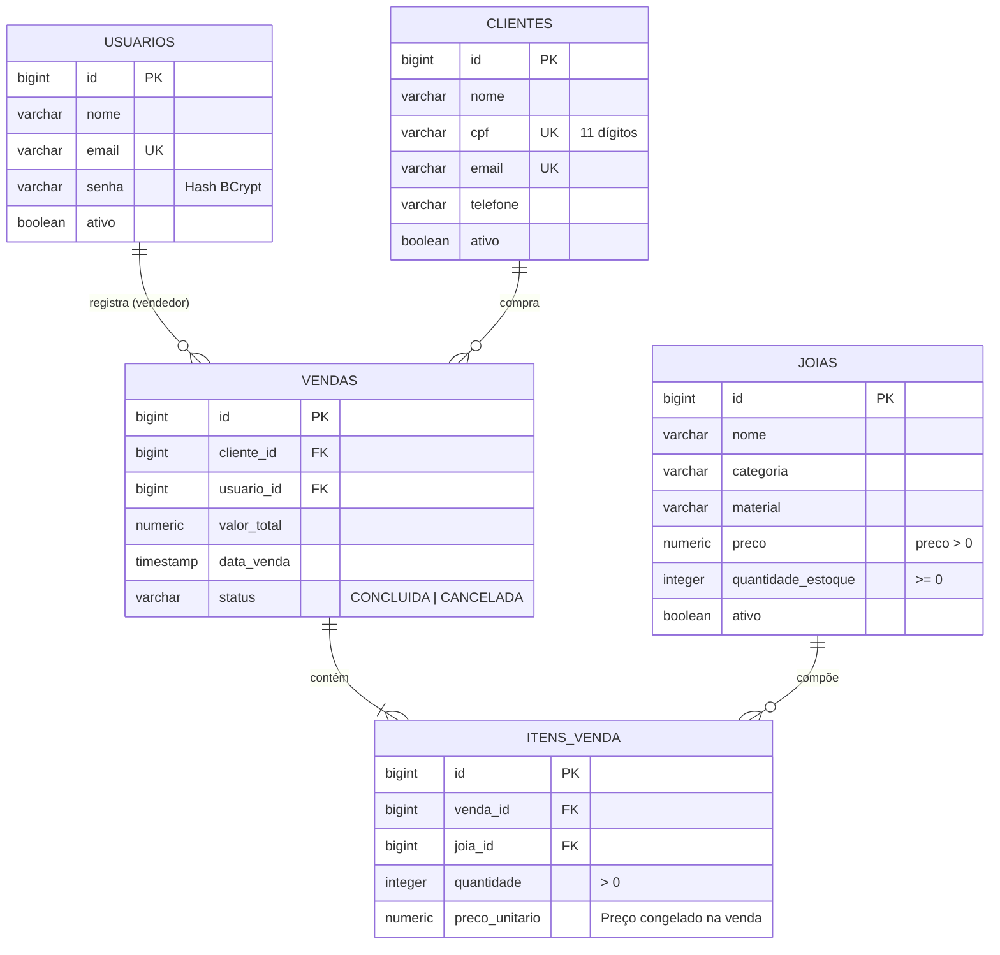

# L&P Royale — Back-End REST API (Spring Boot + PostgreSQL)

**Disciplina:** Testes de Software | Projeto N2  
**Professor:** Reinaldo Jr  
**Integrantes:** Mor e Mor  

---

## 1. Visão Geral da Arquitetura

O back-end do **L&P Royale** é uma API RESTful em **Java 21 + Spring Boot 3.4**, persistida em **PostgreSQL** (gerenciado via **DBeaver**) e protegida com **Spring Security + JWT (stateless) + BCrypt**.

A organização segue a arquitetura em camadas com separação estrita de responsabilidades:

```
back/
├── database/
│   └── lp_joias_postgres.sql        # Script DDL PostgreSQL pronto para inspeção/execução no DBeaver
└── src/
    ├── main/java/com/lproyale/joalheria/
    │   ├── config/                  # SecurityConfig, OpenApiConfig (Swagger), DataSeeder
    │   ├── security/                # JwtService, JwtAuthenticationFilter, UserPrincipal
    │   ├── domain/                  # Entidades JPA (Usuario, Cliente, Joia, Venda, ItemVenda) e Enums
    │   ├── repository/              # Interfaces Spring Data JPA + EntityGraph / queries otimizadas
    │   ├── dto/                     # Java Records (contratos de entrada e saída isolados das entidades)
    │   ├── service/                 # Regras de negócio, transações atômicas (@Transactional) e validações
    │   ├── controller/              # Endpoints REST (/api/auth, /usuarios, /clientes, /joias, /vendas)
    │   └── exception/               # Exceções semânticas e GlobalExceptionHandler (JSON padronizado)
    └── test/java/com/lproyale/joalheria/
        ├── unit/                    # Testes Unitários com JUnit 5 + Mockito
        └── api/                     # Testes de Integração de API com REST-assured
```

---

## 2. Banco de Dados PostgreSQL e DBeaver

### 2.1. Diagrama Entidade-Relacionamento



### 2.2. Passo a Passo de Configuração no DBeaver

1. Certifique-se de que o serviço do **PostgreSQL** (`postgresql-x64-17`) está em execução na porta `5432`.
2. No **DBeaver**, conecte-se ao seu servidor PostgreSQL (`localhost:5432`, usuário `postgres`).
3. Abra um editor SQL no DBeaver e crie o banco do projeto:
   ```sql
   CREATE DATABASE lp_joias;
   ```
4. *(Opcional)* Crie uma conexão no DBeaver apontando diretamente para o banco `lp_joias`. Você pode consultar o script DDL completo em [`database/lp_joias_postgres.sql`](database/lp_joias_postgres.sql).
5. Ao iniciar o back-end Spring Boot, o Hibernate valida/atualiza o schema (`ddl-auto: update`) e o [`DataSeeder`](src/main/java/com/lproyale/joalheria/config/DataSeeder.java) popula automaticamente os registros iniciais (com senhas criptografadas em BCrypt) caso o banco esteja vazio.

### 2.3. Variáveis de Ambiente (opcionais)

As configurações padrão em [`application.yml`](src/main/resources/application.yml) usam `localhost:5432/lp_joias` com usuário/senha `postgres`/`postgres`. Caso sua senha do PostgreSQL seja diferente, configure antes de executar:

```powershell
$env:DB_URL="jdbc:postgresql://localhost:5432/lp_joias"
$env:DB_USER="postgres"
$env:DB_PASSWORD="sua_senha_aqui"
```

---

## 3. Como Executar a API e os Testes

### 3.1. Executar a API Spring Boot
Na pasta `/back`:
```bash
mvn spring-boot:run
```
- API disponível em: `http://localhost:8080/api`
- Swagger UI (documentação interativa): `http://localhost:8080/swagger-ui.html`
- O front-end (`/front`) já possui proxy configurado em `vite.config.ts` redirecionando `/api` para `http://localhost:8080`.

### 3.2. Credenciais de Homologação (DataSeeder)

| E-mail | Senha | Status | Observação |
| :--- | :--- | :--- | :--- |
| `carlos@lproyale.com.br` | `123456` | Ativo | Operador de caixa |
| `marina@lproyale.com.br` | `123456` | Ativo | Gerente |
| `lucas@lproyale.com.br` | `123456` | Inativo | Bloqueado no login (HTTP 403) |

### 3.3. Executar Todos os Testes Automatizados (JUnit + REST-assured)
Os testes utilizam o perfil `test` com banco H2 em modo de compatibilidade PostgreSQL (`MODE=PostgreSQL`), garantindo execução rápida, isolada e determinística:

```bash
mvn test
```

Suíte implementada:
- **Testes Unitários (`unit/` — JUnit 5 + Mockito):**
  - `JoiaServiceUnitTest`: validação de preço positivo, bloqueio `409 Conflict` ao alterar dados cadastrais de joia vendida, permissão de reposição de estoque, exclusão física vs inativação lógica.
  - `UsuarioServiceUnitTest`: bloqueio `409 Conflict` na auto-inativação, e-mail duplicado e reativação de usuário.
  - `VendaServiceUnitTest`: baixa de estoque e cálculo de total, rejeição atômica sem estoque, bloqueio de joia duplicada, estorno no cancelamento.
- **Testes de API (`api/` — REST-assured):**
  - `AuthAndUsuarioApiTest`: fluxo completo de token JWT, bloqueio `401` sem token, bloqueio `403` para usuário inativo, auto-inativação `409` e reativação.
  - `JoiaAndClienteApiTest`: ciclo de cliente (criação, CPF duplicado `409`, inativação, filtro `?ativo=false`, reativação) e regras de joia vendida (`409` cadastral, `PATCH /estoque`, `DELETE` lógico vs físico).
  - `VendaApiTest`: registro com 2 joias distintas, conferência de estoque pós-baixa, edição atômica (`PUT`) e cancelamento (`DELETE`) com estorno integral verificado.

---

## 4. Contrato dos Endpoints REST

| Módulo | Método | Rota | Descrição |
| :--- | :--- | :--- | :--- |
| **Auth** | `POST` | `/api/auth/login` | Autentica operador e retorna `{ token, usuario }` |
| **Usuários** | `GET` | `/api/usuarios` | Lista ativos (ou todos com `?ativo=false`) |
| | `GET` | `/api/usuarios/{id}` | Busca operador por ID |
| | `POST` | `/api/usuarios` | Cria operador com senha em BCrypt |
| | `PUT` | `/api/usuarios/{id}` | Atualiza dados do operador |
| | `DELETE` | `/api/usuarios/{id}` | Inativa operador (`409` se auto-inativação) |
| | `PUT` | `/api/usuarios/{id}/reativar` | Reativa operador inativo |
| **Clientes** | `GET` | `/api/clientes` | Lista ativos (ou todos com `?ativo=false`) |
| | `GET` | `/api/clientes/{id}` | Busca cliente por ID |
| | `POST` | `/api/clientes` | Cadastra cliente (CPF 11 dígitos e e-mail únicos) |
| | `PUT` | `/api/clientes/{id}` | Atualiza cliente |
| | `DELETE` | `/api/clientes/{id}` | Inativa cliente |
| | `PUT` | `/api/clientes/{id}/reativar` | Reativa cliente |
| **Joias** | `GET` | `/api/joias` | Lista ativas (ou todas com `?ativo=false`), incluindo `possuiVendas` |
| | `GET` | `/api/joias/{id}` | Detalhes da joia com `possuiVendas` |
| | `POST` | `/api/joias` | Cadastra joia |
| | `PUT` | `/api/joias/{id}` | Edita joia (`409` em dados cadastrais se já vendida; permite estoque) |
| | `PATCH/PUT` | `/api/joias/{id}/estoque` | Reposição/ajuste manual de estoque |
| | `DELETE` | `/api/joias/{id}` | Exclusão física se sem vendas (`deleted: true`); soft delete se com vendas (`inactivated: true`) |
| | `PUT` | `/api/joias/{id}/reativar` | Reativa joia inativa |
| **Vendas** | `GET` | `/api/vendas` | Histórico completo de vendas (mais recentes primeiro) |
| | `GET` | `/api/vendas/{id}` | Detalhes da venda com cliente, vendedor e itens |
| | `POST` | `/api/vendas` | Registra venda com baixa atômica de estoque |
| | `PUT` | `/api/vendas/{id}` | Edita cliente e itens preservando `precoUnitario` dos itens mantidos |
| | `DELETE` | `/api/vendas/{id}` | Cancela venda (`CANCELADA`) e estorna estoque |

---

## 5. Guia Rápido de Decisões Arquiteturais (Para Apresentação ao Professor)

1. **Por que usar DTOs (`Java records`) em vez de expor Entidades JPA diretamente nos Controllers?**  
   Evita acoplamento entre o modelo relacional e o contrato JSON da API, previne referências circulares (`Venda -> ItemVenda -> Venda`) e impede vazamento de campos sensíveis como `Usuario.senha`.
2. **Por que `BigDecimal` com `compareTo` para valores monetários?**  
   Tipos de ponto flutuante (`double`/`float`) sofrem erros de arredondamento binário em operações financeiras. `BigDecimal` garante precisão exata de centavos, e `compareTo` compara valores numericamente ignorando diferenças de escala (ex: `2450.0` vs `2450.00`).
3. **Por que `precoUnitario` é gravado na tabela `itens_venda`?**  
   Garante integridade histórica/fiscal: se o preço de uma joia subir no catálogo no futuro, o valor das vendas antigas permanece fiel ao preço cobrado na época.
4. **Por que `open-in-view: false` e `@EntityGraph` em `VendaRepository`?**  
   Desabilitar `OSIV` evita consultas SQL ocultas durante a serialização JSON e previne o problema **N+1**. O `@EntityGraph` carrega venda, cliente, vendedor, itens e joias em uma consulta previsível.
5. **Como a atomicidade de estoque é garantida em `POST` e `PUT` de Vendas?**  
   Os métodos de criação, edição e cancelamento rodam sob `@Transactional`. Se qualquer item falhar na validação de estoque ou status ativo, o Spring/JPA executa *rollback* completo, mantendo o estoque intacto. Na edição (`PUT`), o `saveAndFlush` após limpar os itens antigos evita conflito na constraint `UNIQUE (venda_id, joia_id)` antes de reinserir os novos itens.
6. **Por que `BCrypt` e JWT Stateless?**  
   `BCrypt` aplica *salt* automático e custo computacional contra ataques de força bruta. A autenticação *stateless* via JWT (`Bearer`) elimina sessão em memória no servidor e se integra diretamente ao interceptor Axios do front-end.
7. **Por que os testes automatizados usam perfil `test` com H2 em modo PostgreSQL?**  
   Permite rodar `mvn test` em qualquer máquina ou CI sem depender de banco externo ativo e sem sujar os dados reais do PostgreSQL no DBeaver, mantendo compatibilidade SQL (`MODE=PostgreSQL`).

