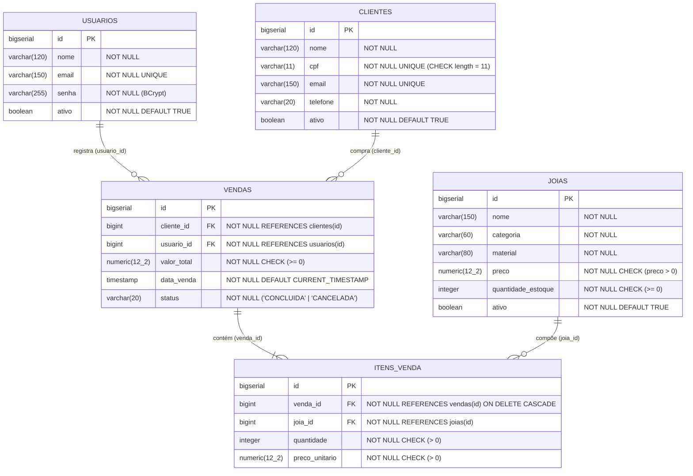

# Documento de Especificação de Requisitos de Software (ERS) — Sistema L&P Joias

**Disciplina:** Testes de Software | Projeto N2  
**Professor:** Reinaldo de Souza Junior  
**Integrantes:** Layane Lino e Pedro Moreira

---

## 1. Introdução e Objetivo do Sistema

### 1.1. Propósito
Este documento especifica de forma completa os **Requisitos Funcionais (RF)**, **Requisitos Não Funcionais (RNF)**, **Regras de Negócio (RN)**, **Modelo de Dados Relacional**, **Contratos de Interface (API REST e DTOs)** e **Rastreabilidade de Testes Automatizados** do sistema **L&P Joias — Sistema de Gestão e Vendas de Joalheria**.

### 1.2. Escopo do Produto
O **L&P Joias** é uma aplicação web Full Stack local projetada para operação em balcão e frente de caixa (PDV) por funcionários de uma joalheria física. O sistema integra uma **Single Page Application (SPA)** em React 19 + TypeScript a uma **API RESTful** em Java 21 + Spring Boot 3.4 persistida em **PostgreSQL**, garantindo:
- Autenticação segura *stateless* via JWT e senhas criptografadas com BCrypt;
- Gestão completa de operadores/usuários, clientes, catálogo de joias, estoque físico e operações de venda;
- Controle transacional atômico de baixa e estorno de estoque;
- Preservação histórica e fiscal por meio de *soft delete*, congelamento de preço unitário em vendas e bloqueio de alterações cadastrais em peças já comercializadas;
- Cobertura integral da pirâmide de testes automatizados (Unitários com JUnit 5 + Mockito, Integração de API com REST-assured e End-to-End com Selenium WebDriver).

### 1.3. Fora de Escopo
- E-commerce voltado para autoatendimento do consumidor final;
- Exclusão física definitiva de usuários, clientes ou vendas;
- Reativação ou edição de vendas canceladas;
- Upload e armazenamento de arquivos de mídia/imagens de produtos;
- Controle granular de permissões por papéis (RBAC multinível — todos os operadores ativos possuem permissão operacional completa);
- Integração com hardware fiscal (SAT/NFC-e) ou gateways bancários externos (TEF/Pix externo).

---

## 2. Atores e Perfis do Sistema

| Ator / Entidade | Tipo | Descrição e Responsabilidades no Sistema |
| :--- | :--- | :--- |
| **Operador / Funcionário (`Usuario`)** | Ator Primário | Funcionário da joalheria (vendedor de balcão, operador de caixa ou gerente). Autentica-se via e-mail e senha (`ROLE_OPERADOR`) e executa todas as operações do PDV e cadastros. |
| **Cliente (`Cliente`)** | Entidade Passiva | Comprador pessoa física cadastrado na loja com CPF (11 dígitos), nome, e-mail e telefone. Não realiza login; é vinculado obrigatoriamente às operações de venda. |
| **Catálogo de Joias (`Joia`)** | Recurso de Domínio | Peça comercializada pela joalheria com categoria, material, preço unitário e saldo físico em estoque. |
| **Venda (`Venda` / `ItemVenda`)** | Transação de Negócio | Registro fiscal/operacional de uma compra realizada por um cliente, atendida pelo operador autenticado, composta por um ou mais itens distintos com preço unitário congelado no ato da venda. |

### 2.1. Fluxo Operacional de uma Venda
1. O funcionário realiza login no sistema.
2. O cliente escolhe uma ou mais joias na loja física.
3. O funcionário abre a tela de venda (PDV), seleciona o cliente e adiciona cada joia com a respectiva quantidade.
4. O funcionário confirma a venda.
5. O sistema valida o estoque de todos os itens, baixa o estoque, calcula o valor total e grava a venda vinculada ao funcionário responsável autenticado.
6. Se necessário, o funcionário edita os itens da venda ou a cancela; o sistema ajusta/estorna o estoque de acordo de forma transacional.

### 2.2. Resumo de Funcionalidades por Entidade

| Entidade | Criar | Listar | Buscar por ID | Editar | Excluir | Funcionalidade Especial |
| :--- | :---: | :---: | :---: | :--- | :--- | :--- |
| **Usuario** | Sim | Sim | Sim | Sim | Inativa | Login e reativação |
| **Cliente** | Sim | Sim | Sim | Sim | Inativa | Reativação |
| **Joia** | Sim | Sim | Sim | Só sem vendas | Exclui ou inativa | Ajuste de estoque e reativação |
| **Venda** | Sim | Sim | Sim | Sim | Cancela | Baixa e devolução de estoque |
| **ItemVenda** | Com a venda | Na venda | Na venda | Com a venda | Com a venda | — |

---

## 3. Requisitos Funcionais (RF)

### 3.1. Módulo de Autenticação e Controle de Sessão (`Auth`)

| Código | Requisito | Descrição Detalhada (Baseada no Código) |
| :--- | :--- | :--- |
| **RF-AUTH-01** | Realizar Login com JWT | O sistema deve autenticar o operador via `POST /api/auth/login` recebendo `email` e `senha`. Caso as credenciais sejam válidas e o operador esteja ativo, retorna `HTTP 200 OK` contendo o token JWT assinado (`uid`, `nome`, `sub`, `iat`, `exp`) e os dados públicos do operador (`id`, `nome`, `email`, `ativo`). |
| **RF-AUTH-02** | Rejeitar Credenciais Inválidas | Caso o e-mail não exista ou a senha informada não corresponda ao hash BCrypt armazenado, o sistema deve retornar `HTTP 401 Unauthorized` com a mensagem `"E-mail ou senha inválidos."`. |
| **RF-AUTH-03** | Bloquear Login de Operador Inativo | Caso o e-mail e a senha estejam corretos, mas o operador possua `ativo = false`, o sistema deve impedir a emissão do token e retornar `HTTP 403 Forbidden` com a mensagem `"Usuário inativo não tem permissão para acessar o sistema."`. |
| **RF-AUTH-04** | Proteger Rotas Privadas via Filtro JWT | Todas as rotas sob `/api/**` (exceto `POST /api/auth/login` e rotas do Swagger) devem exigir o cabeçalho `Authorization: Bearer <token>`. O filtro `JwtAuthenticationFilter` valida a assinatura, a expiração e se o usuário continua com `ativo = true` no banco a cada requisição, retornando `HTTP 401 Unauthorized` caso contrário. |
| **RF-AUTH-05** | Encerrar Sessão (Logout) | O front-end deve permitir o encerramento da sessão (`[data-testid="btn-logout"]`), removendo o token JWT (`aurea_token`) e os dados do usuário (`aurea_user`) do `localStorage` e redirecionando para `/login`. |

### 3.2. Módulo de Gestão de Operadores (`Usuários`)

| Código | Requisito | Descrição Detalhada (Baseada no Código) |
| :--- | :--- | :--- |
| **RF-USU-01** | Listar Operadores | O endpoint `GET /api/usuarios` deve retornar os operadores ordenados por `id ASC`. Por padrão, retorna apenas registros com `ativo = true`. Quando informado o parâmetro `?ativo=false`, retorna todos os operadores (ativos e inativos). |
| **RF-USU-02** | Buscar Operador por ID | O endpoint `GET /api/usuarios/{id}` deve retornar os dados do operador correspondente (`HTTP 200`) ou `HTTP 404 Not Found` caso o ID não exista. |
| **RF-USU-03** | Cadastrar Novo Operador | O endpoint `POST /api/usuarios` deve cadastrar um operador ativo validando nome obrigatório (máx. 120 caracteres), e-mail válido e único (máx. 150 caracteres, normalizado em minúsculas) e senha com mínimo de 6 caracteres (armazenada com hash BCrypt), retornando `HTTP 201 Created`. |
| **RF-USU-04** | Atualizar Dados de Operador | O endpoint `PUT /api/usuarios/{id}` deve permitir alterar nome, e-mail (validando unicidade contra outros IDs) e opcionalmente a senha (re-gerando o hash BCrypt se informada). |
| **RF-USU-05** | Inativar Operador (*Soft Delete*) | O endpoint `DELETE /api/usuarios/{id}` deve inativar logicamente o operador (`ativo = false`) retornando `HTTP 204 No Content`, impedindo que o operador autenticado inative a si mesmo (`HTTP 409 Conflict`). |
| **RF-USU-06** | Reativar Operador | O endpoint `PUT /api/usuarios/{id}/reativar` deve alterar o status de um operador inativo para `ativo = true` (`HTTP 200 OK`), ou retornar `HTTP 409 Conflict` caso o operador já esteja ativo. |

### 3.3. Módulo de Gestão de Clientes (`Clientes`)

| Código | Requisito | Descrição Detalhada (Baseada no Código) |
| :--- | :--- | :--- |
| **RF-CLI-01** | Listar Clientes | O endpoint `GET /api/clientes` deve listar clientes ordenados por `id ASC`, filtrando apenas ativos por padrão e exibindo todos (ativos e inativos) quando enviado `?ativo=false`. |
| **RF-CLI-02** | Buscar Cliente por ID | O endpoint `GET /api/clientes/{id}` deve retornar os dados do cliente (`HTTP 200`) ou `HTTP 404 Not Found` se inexistente. |
| **RF-CLI-03** | Cadastrar Cliente com Normalização de CPF | O endpoint `POST /api/clientes` deve receber nome, CPF, e-mail e telefone, remover caracteres não numéricos do CPF (`replaceAll("\\D", "")`), validar que possui exatamente 11 dígitos numéricos (`HTTP 400` se inválido) e verificar unicidade de CPF e e-mail (`HTTP 409 Conflict` se duplicados), retornando `HTTP 201 Created`. |
| **RF-CLI-04** | Atualizar Cliente | O endpoint `PUT /api/clientes/{id}` deve permitir atualizar nome, CPF (normalizado com 11 dígitos e único), e-mail (único) e telefone. |
| **RF-CLI-05** | Inativar Cliente (*Soft Delete*) | O endpoint `DELETE /api/clientes/{id}` deve definir `ativo = false` (`HTTP 204 No Content`), preservando integralmente o histórico de compras anteriores do cliente. |
| **RF-CLI-06** | Reativar Cliente | O endpoint `PUT /api/clientes/{id}/reativar` deve restaurar `ativo = true` (`HTTP 200 OK`), retornando `HTTP 409 Conflict` caso o cliente já se encontre ativo. |

### 3.4. Módulo de Catálogo de Joias e Controle de Estoque (`Joias`)

| Código | Requisito | Descrição Detalhada (Baseada no Código) |
| :--- | :--- | :--- |
| **RF-JOI-01** | Listar Joias com Indicador `possuiVendas` | O endpoint `GET /api/joias` deve retornar as joias ordenadas por `id ASC` (ativas por padrão, ou todas com `?ativo=false`). Cada item deve incluir o campo booleano `possuiVendas` calculado em tempo de execução a partir de `itens_venda`. |
| **RF-JOI-02** | Buscar Joia por ID | O endpoint `GET /api/joias/{id}` deve retornar os detalhes da joia junto à flag `possuiVendas` (`HTTP 200`) ou `HTTP 404 Not Found`. |
| **RF-JOI-03** | Cadastrar Nova Joia | O endpoint `POST /api/joias` deve cadastrar uma nova peça ativa com `nome` (máx. 150), `categoria` (máx. 60), `material` (máx. 80), `preco` (`> 0.00`) e `quantidadeEstoque` (`>= 0`), retornando `HTTP 201 Created` com `possuiVendas = false`. |
| **RF-JOI-04** | Editar Dados Cadastrais da Joia | O endpoint `PUT /api/joias/{id}` deve permitir atualizar `nome`, `categoria`, `material`, `preco` e `quantidadeEstoque` caso a joia **nunca tenha participado de uma venda**. Caso `possuiVendas == true` e haja tentativa de alterar `nome`, `categoria`, `material` ou `preco`, deve bloquear a operação com `HTTP 409 Conflict`. |
| **RF-JOI-05** | Ajustar / Repor Saldo de Estoque | O endpoint `PATCH /api/joias/{id}/estoque` (também aceito via `PUT /api/joias/{id}/estoque` ou `PUT /api/joias/{id}` enviando apenas `quantidadeEstoque`) deve atualizar o saldo físico (`>= 0`) mesmo para joias que já possuem vendas registradas. |
| **RF-JOI-06** | Exclusão Condicional (Física vs. Lógica) | O endpoint `DELETE /api/joias/{id}` deve verificar se a joia possui vínculo em `itens_venda`:<br>• **Sem vendas (`possuiVendas = false`):** executa exclusão física no banco (`DELETE FROM joias`) e retorna `{ "deleted": true, "inactivated": false }`.<br>• **Com vendas (`possuiVendas = true`):** executa inativação lógica (`ativo = false`) e retorna `{ "deleted": false, "inactivated": true }`. |
| **RF-JOI-07** | Reativar Joia Inativa | O endpoint `PUT /api/joias/{id}/reativar` deve restaurar `ativo = true` para uma joia inativa (`HTTP 200 OK`), ou retornar `HTTP 409 Conflict` se já estiver ativa. |

### 3.5. Módulo de Frente de Caixa — PDV e Histórico de Vendas (`Vendas`)

| Código | Requisito | Descrição Detalhada (Baseada no Código) |
| :--- | :--- | :--- |
| **RF-VEN-01** | Listar Histórico de Vendas | O endpoint `GET /api/vendas` deve listar todas as vendas ordenadas da mais recente para a mais antiga (`ORDER BY id DESC`), carregando em consulta otimizada (`@EntityGraph`) os dados do cliente, do operador vendedor e dos itens com suas respectivas joias. |
| **RF-VEN-02** | Consultar Comprovante Detalhado da Venda | O endpoint `GET /api/vendas/{id}` deve retornar todos os dados da venda, incluindo lista de itens com `quantidade`, `precoUnitario` praticado na época e subtotal, ou `HTTP 404 Not Found`. |
| **RF-VEN-03** | Registrar Nova Venda no PDV | O endpoint `POST /api/vendas` deve registrar uma venda com status `CONCLUIDA` e `dataVenda` atual, vinculando automaticamente o operador autenticado no token JWT (`UserPrincipal.id`) e o `clienteId` informado, debitando atomicamente o estoque de cada joia, congelando `precoUnitario = joia.preco` e calculando `valorTotal`, retornando `HTTP 201 Created`. |
| **RF-VEN-04** | Editar Venda Concluída | O endpoint `PUT /api/vendas/{id}` deve permitir alterar o cliente e a lista de itens de uma venda com status `CONCLUIDA`. De forma transacional, o sistema estorna o estoque dos itens anteriores, aplica as novas quantidades, **preserva o `precoUnitario` original para joias que já constavam na venda**, utiliza o preço atual de catálogo para novas joias incluídas e recalcula o `valorTotal`. |
| **RF-VEN-05** | Cancelar Venda com Estorno de Estoque | O endpoint `DELETE /api/vendas/{id}` deve alterar o status da venda para `CANCELADA` e devolver integralmente a quantidade de cada item ao `quantidadeEstoque` da respectiva joia (`HTTP 200 OK`). |
| **RF-VEN-06** | Operação de Frente de Caixa na Interface (SPA) | A tela de PDV (`/`) deve permitir filtrar joias ativas por termo de busca (nome, material ou `#ID`) e por categoria, selecionar cliente ativo, adicionar itens ao cupom respeitando o limite de estoque em tempo real e finalizar a venda. |

---

## 4. Catálogo Completo de Regras de Negócio (RN)

| Código | Regra de Negócio | Módulo | Código HTTP em Caso de Violação | Implementação no Código |
| :--- | :--- | :--- | :---: | :--- |
| **RN-01** | Usuários, clientes e vendas nunca são excluídos fisicamente do banco de dados (*Soft Delete*). | Geral | — | `UsuarioService.inactivate`, `ClienteService.inactivate`, `VendaService.cancel` |
| **RN-02** | Joia que **nunca** participou de uma venda é excluída fisicamente ao acionar `DELETE /api/joias/{id}`. | Joias | `200 OK` (`deleted: true`) | `JoiaService.deleteOrInactivate` |
| **RN-03** | Joia que **já participou** de ao menos uma venda (concluída ou cancelada) não pode ser excluída fisicamente (`DELETE` apenas inativa) e não pode ter `nome`, `categoria`, `material` ou `preco` alterados. | Joias | `409 Conflict` (no `PUT`) | `JoiaService.update` (`hasCadastralChanges`) e `deleteOrInactivate` |
| **RN-04** | O ajuste/reposição de saldo de estoque (`quantidadeEstoque`) é sempre permitido, inclusive para joias que já possuem histórico de vendas. | Joias | `200 OK` | `JoiaService.adjustStock` e `JoiaService.update` |
| **RN-05** | O preço unitário de uma joia deve ser estritamente maior que zero (`preco >= 0.01`). | Joias | `400 Bad Request` | `JoiaCreateRequest`, `JoiaUpdateRequest`, `JoiaService.validatePreco` |
| **RN-06** | A quantidade em estoque de uma joia nunca pode ser negativa (`quantidadeEstoque >= 0`). | Joias | `400 Bad Request` | `JoiaCreateRequest`, `EstoqueRequest`, `JoiaService.validateEstoque` |
| **RN-07** | O CPF (exatamente 11 dígitos numéricos após limpeza de máscara) e o e-mail do cliente são obrigatórios e únicos no sistema. | Clientes | `400 Bad Request` / `409 Conflict` | `ClienteService.normalizeAndValidateCpf`, `create`, `update` |
| **RN-08** | O e-mail do operador (`Usuario`) é obrigatório e único no sistema (comparação *case-insensitive*). | Usuários | `409 Conflict` | `UsuarioService.create`, `UsuarioService.update` |
| **RN-09** | Operador com `ativo = false` não pode obter token no login nem utilizar tokens emitidos anteriormente. | Auth / Segurança | `403 Forbidden` (login) / `401 Unauthorized` (filtro) | `AuthService.login`, `JwtAuthenticationFilter` |
| **RN-10** | Clientes inativos (`ativo = false`) e joias inativas (`ativo = false`) não podem ser incluídos em novas vendas ou edições de vendas. | Vendas | `400 Bad Request` | `VendaService.findActiveClienteOrThrow`, `applyItemsAndDebitStock` |
| **RN-11** | As listagens de `/api/usuarios`, `/api/clientes` e `/api/joias` retornam apenas registros ativos por padrão e retornam todos os registros quando `?ativo=false`. | Geral | `200 OK` | `UsuarioService.findAll`, `ClienteService.findAll`, `JoiaService.findAll` |
| **RN-12** | Tentar reativar um usuário, cliente ou joia que já se encontra com `ativo = true` é rejeitado como conflito de estado. | Geral | `409 Conflict` | `UsuarioService.reactivate`, `ClienteService.reactivate`, `JoiaService.reactivate` |
| **RN-13** | Um operador autenticado **não pode inativar a si mesmo** (comparação entre o `id` da URL e o `id` do `UserPrincipal` extraído do JWT). | Usuários | `409 Conflict` | `UsuarioService.inactivate` |
| **RN-14** | O vendedor responsável pela venda é sempre extraído do token JWT do operador autenticado, nunca enviado livremente no payload da requisição. | Vendas | — | `VendaController.create` (`@AuthenticationPrincipal`) |
| **RN-15** | Toda venda exige um cliente existente e ativo e deve conter pelo menos 1 item na lista `itens`. | Vendas | `400 Bad Request` / `404 Not Found` | `VendaRequest` (`@NotEmpty`), `VendaService.validateItensRequest` |
| **RN-16** | A quantidade de cada item da venda deve ser um inteiro estritamente positivo (`quantidade >= 1`). | Vendas | `400 Bad Request` | `ItemVendaRequest` (`@Min(1)`), `VendaService.validateItensRequest` |
| **RN-17** | A mesma joia (`joiaId`) **não pode aparecer mais de uma vez** na mesma venda; quantidades adicionais devem ser somadas no mesmo item. | Vendas | `400 Bad Request` | `VendaService.validateItensRequest` e constraint `uk_item_venda_joia` |
| **RN-18** | Se qualquer item da venda solicitar quantidade superior ao `quantidadeEstoque` disponível da joia, **a venda inteira é rejeitada atomicamente** (*rollback*), sem debitar nenhum item. | Vendas | `400 Bad Request` | `VendaService.applyItemsAndDebitStock` (`@Transactional`) |
| **RN-19** | Ao confirmar uma venda, o estoque de cada joia é debitado e o `precoUnitario` vigente é congelado no registro `ItemVenda`, calculando `valorTotal = Σ(quantidade × precoUnitario)`. | Vendas | — | `VendaService.applyItemsAndDebitStock`, `Venda.recalcularValorTotal` |
| **RN-20** | Ao cancelar uma venda (`DELETE /api/vendas/{id}`), seu status muda para `CANCELADA` e as quantidades de todos os seus itens são devolvidas ao estoque das respectivas joias. | Vendas | `200 OK` | `VendaService.cancel` |
| **RN-21** | Uma venda com status `CANCELADA` não pode ser cancelada novamente nem pode ser editada via `PUT`. | Vendas | `409 Conflict` | `VendaService.cancel`, `VendaService.update` |

---

## 5. Requisitos Não Funcionais (RNF)

| Código | Categoria | Especificação Técnica |
| :--- | :--- | :--- |
| **RNF-01** | **Segurança e Criptografia** | Autenticação *stateless* (`SessionCreationPolicy.STATELESS`) via JWT HMAC-SHA com tempo de expiração configurável (padrão 8h / `28800000 ms`) e senhas criptografadas com `BCryptPasswordEncoder`. |
| **RNF-02** | **Integridade Transacional** | Todas as operações de escrita em serviços (`create`, `update`, `inactivate`, `reactivate`, `cancel`) executam sob `@Transactional` do Spring, garantindo atomicidade ACID no PostgreSQL. |
| **RNF-03** | **Precisão Monetária** | Valores financeiros (`Joia.preco`, `ItemVenda.precoUnitario`, `Venda.valorTotal`) utilizam `BigDecimal` com precisão `NUMERIC(12, 2)` no banco e comparação numérica via `compareTo`. |
| **RNF-04** | **Desempenho e Prevenção de N+1** | `spring.jpa.open-in-view` desabilitado (`false`) e uso de `@EntityGraph(attributePaths = {"cliente", "usuario", "itens", "itens.joia"})` em `VendaRepository` para carregamento em consulta única. |
| **RNF-05** | **Padronização de Erros HTTP** | Respostas de erro seguem o contrato único `ApiErrorResponse` (`timestamp`, `status`, `error`, `message`, `path`) gerenciado centralmente por `GlobalExceptionHandler`. |
| **RNF-06** | **Testabilidade E2E Determinística** | Todos os componentes interativos críticos do front-end possuem atributos `data-testid` imutáveis para automação com Selenium WebDriver. |
| **RNF-07** | **Resiliência Front-End (Dual-Mode)** | O front-end opera conectado à API Spring Boot (`/api`) por padrão e dispõe de modo de simulação local (`LocalStore`) espelhando todas as regras de negócio para contingência e demonstração. |

---

## 6. Modelo de Dados Relacional (PostgreSQL)

### 6.1. Diagrama Entidade-Relacionamento



### 6.2. Dicionário de Dados e Restrições de Integridade (DDL)

| Tabela | Coluna | Tipo SQL | Tipo Java | Restrições no Banco e na Aplicação |
| :--- | :--- | :--- | :--- | :--- |
| **`usuarios`** | `id` | `BIGSERIAL` | `Long` | `PRIMARY KEY` |
| | `nome` | `VARCHAR(120)` | `String` | `NOT NULL`, `@NotBlank`, `@Size(max = 120)` |
| | `email` | `VARCHAR(150)` | `String` | `NOT NULL`, `UNIQUE`, `@Email`, `@Size(max = 150)` |
| | `senha` | `VARCHAR(255)` | `String` | `NOT NULL`, `@Size(min = 6, max = 100)` na entrada, Hash BCrypt no banco |
| | `ativo` | `BOOLEAN` | `Boolean` | `NOT NULL DEFAULT TRUE` (Índice `idx_usuarios_ativo`) |
| **`clientes`** | `id` | `BIGSERIAL` | `Long` | `PRIMARY KEY` |
| | `nome` | `VARCHAR(120)` | `String` | `NOT NULL`, `@NotBlank`, `@Size(max = 120)` |
| | `cpf` | `VARCHAR(11)` | `String` | `NOT NULL`, `UNIQUE`, `CHECK (char_length(cpf) = 11)` |
| | `email` | `VARCHAR(150)` | `String` | `NOT NULL`, `UNIQUE`, `@Email`, `@Size(max = 150)` |
| | `telefone` | `VARCHAR(20)` | `String` | `NOT NULL`, `@NotBlank`, `@Size(max = 20)` |
| | `ativo` | `BOOLEAN` | `Boolean` | `NOT NULL DEFAULT TRUE` (Índice `idx_clientes_ativo`) |
| **`joias`** | `id` | `BIGSERIAL` | `Long` | `PRIMARY KEY` |
| | `nome` | `VARCHAR(150)` | `String` | `NOT NULL`, `@NotBlank`, `@Size(max = 150)` |
| | `categoria` | `VARCHAR(60)` | `String` | `NOT NULL`, `@NotBlank`, `@Size(max = 60)` |
| | `material` | `VARCHAR(80)` | `String` | `NOT NULL`, `@NotBlank`, `@Size(max = 80)` |
| | `preco` | `NUMERIC(12,2)`| `BigDecimal`| `NOT NULL`, `CHECK (preco > 0)`, `@DecimalMin("0.01")` |
| | `quantidade_estoque`| `INTEGER` | `Integer` | `NOT NULL`, `CHECK (quantidade_estoque >= 0)`, `@Min(0)` |
| | `ativo` | `BOOLEAN` | `Boolean` | `NOT NULL DEFAULT TRUE` (Índice `idx_joias_ativo`) |
| **`vendas`** | `id` | `BIGSERIAL` | `Long` | `PRIMARY KEY` |
| | `cliente_id` | `BIGINT` | `Cliente` | `NOT NULL REFERENCES clientes(id)` |
| | `usuario_id` | `BIGINT` | `Usuario` | `NOT NULL REFERENCES usuarios(id)` |
| | `valor_total` | `NUMERIC(12,2)`| `BigDecimal`| `NOT NULL`, `CHECK (valor_total >= 0)` |
| | `data_venda` | `TIMESTAMP` | `LocalDateTime`| `NOT NULL DEFAULT CURRENT_TIMESTAMP` (Índice `idx_vendas_data`) |
| | `status` | `VARCHAR(20)` | `StatusVenda`| `NOT NULL`, `CHECK (status IN ('CONCLUIDA', 'CANCELADA'))` |
| **`itens_venda`**| `id` | `BIGSERIAL` | `Long` | `PRIMARY KEY` |
| | `venda_id` | `BIGINT` | `Venda` | `NOT NULL REFERENCES vendas(id) ON DELETE CASCADE` |
| | `joia_id` | `BIGINT` | `Joia` | `NOT NULL REFERENCES joias(id)` (Índice `idx_itens_venda_joia`) |
| | `quantidade` | `INTEGER` | `Integer` | `NOT NULL`, `CHECK (quantidade > 0)`, `@Min(1)` |
| | `preco_unitario`| `NUMERIC(12,2)`| `BigDecimal`| `NOT NULL`, `CHECK (preco_unitario > 0)`, `UNIQUE(venda_id, joia_id)` |

---

## 7. Especificação dos Contratos da API REST e DTOs

### 7.1. Matriz de Endpoints e Códigos de Resposta

| Módulo | Método | Rota | Request DTO | Response DTO | Códigos HTTP Possíveis |
| :--- | :---: | :--- | :--- | :--- | :--- |
| **Auth** | `POST` | `/api/auth/login` | `LoginRequest` | `AuthResponse` | `200`, `400`, `401`, `403` |
| **Usuários** | `GET` | `/api/usuarios` | Query `?ativo=false` (opc.) | `List<UsuarioResponse>` | `200`, `401` |
| | `GET` | `/api/usuarios/{id}` | — | `UsuarioResponse` | `200`, `401`, `404` |
| | `POST` | `/api/usuarios` | `UsuarioCreateRequest` | `UsuarioResponse` | `201`, `400`, `401`, `409` |
| | `PUT` | `/api/usuarios/{id}` | `UsuarioUpdateRequest` | `UsuarioResponse` | `200`, `400`, `401`, `404`, `409` |
| | `DELETE` | `/api/usuarios/{id}` | — | Sem corpo | `204`, `401`, `404`, `409` |
| | `PUT` | `/api/usuarios/{id}/reativar`| — | `UsuarioResponse` | `200`, `401`, `404`, `409` |
| **Clientes** | `GET` | `/api/clientes` | Query `?ativo=false` (opc.) | `List<ClienteResponse>` | `200`, `401` |
| | `GET` | `/api/clientes/{id}` | — | `ClienteResponse` | `200`, `401`, `404` |
| | `POST` | `/api/clientes` | `ClienteRequest` | `ClienteResponse` | `201`, `400`, `401`, `409` |
| | `PUT` | `/api/clientes/{id}` | `ClienteUpdateRequest` | `ClienteResponse` | `200`, `400`, `401`, `404`, `409` |
| | `DELETE` | `/api/clientes/{id}` | — | Sem corpo | `204`, `401`, `404` |
| | `PUT` | `/api/clientes/{id}/reativar`| — | `ClienteResponse` | `200`, `401`, `404`, `409` |
| **Joias** | `GET` | `/api/joias` | Query `?ativo=false` (opc.) | `List<JoiaResponse>` | `200`, `401` |
| | `GET` | `/api/joias/{id}` | — | `JoiaResponse` | `200`, `401`, `404` |
| | `POST` | `/api/joias` | `JoiaCreateRequest` | `JoiaResponse` | `201`, `400`, `401` |
| | `PUT` | `/api/joias/{id}` | `JoiaUpdateRequest` | `JoiaResponse` | `200`, `400`, `401`, `404`, `409` |
| | `PATCH/PUT`| `/api/joias/{id}/estoque` | `EstoqueRequest` | `JoiaResponse` | `200`, `400`, `401`, `404` |
| | `DELETE` | `/api/joias/{id}` | — | `JoiaDeleteResponse` | `200`, `401`, `404` |
| | `PUT` | `/api/joias/{id}/reativar` | — | `JoiaResponse` | `200`, `401`, `404`, `409` |
| **Vendas** | `GET` | `/api/vendas` | — | `List<VendaResponse>` | `200`, `401` |
| | `GET` | `/api/vendas/{id}` | — | `VendaResponse` | `200`, `401`, `404` |
| | `POST` | `/api/vendas` | `VendaRequest` | `VendaResponse` | `201`, `400`, `401`, `404` |
| | `PUT` | `/api/vendas/{id}` | `VendaRequest` | `VendaResponse` | `200`, `400`, `401`, `404`, `409` |
| | `DELETE` | `/api/vendas/{id}` | — | `VendaResponse` | `200`, `401`, `404`, `409` |

### 7.2. Exemplos de Contratos JSON

#### A) Registro e Edição de Venda (`POST /api/vendas` e `PUT /api/vendas/{id}`)
**Request:**
```json
{
  "clienteId": 1,
  "itens": [
    { "joiaId": 1, "quantidade": 1 },
    { "joiaId": 3, "quantidade": 2 }
  ]
}
```
**Response (`201 Created` / `200 OK`):**
```json
{
  "id": 3,
  "clienteId": 1,
  "cliente": {
    "id": 1,
    "nome": "Ana Beatriz Souza",
    "cpf": "12345678901",
    "email": "ana.souza@email.com",
    "telefone": "11987654321",
    "ativo": true
  },
  "usuarioId": 1,
  "usuario": {
    "id": 1,
    "nome": "Carlos Silva",
    "email": "carlos@lpjoias.com.br",
    "ativo": true
  },
  "valorTotal": 3290.00,
  "dataVenda": "2026-11-15T18:30:00",
  "status": "CONCLUIDA",
  "itens": [
    {
      "id": 3,
      "joiaId": 1,
      "joia": {
        "id": 1,
        "nome": "Anel Solitário Ouro 18k",
        "categoria": "Anel",
        "material": "Ouro 18k",
        "preco": 2450.00,
        "quantidadeEstoque": 5,
        "ativo": true,
        "possuiVendas": true
      },
      "quantidade": 1,
      "precoUnitario": 2450.00
    },
    {
      "id": 4,
      "joiaId": 3,
      "joia": {
        "id": 3,
        "nome": "Brincos Pérola Cultivada",
        "categoria": "Brinco",
        "material": "Prata 925",
        "preco": 420.00,
        "quantidadeEstoque": 8,
        "ativo": true,
        "possuiVendas": true
      },
      "quantidade": 2,
      "precoUnitario": 420.00
    }
  ]
}
```

#### B) Contrato Padronizado de Erro (`ApiErrorResponse`)
```json
{
  "timestamp": "2026-11-15T18:32:10.412",
  "status": 409,
  "error": "Conflict",
  "message": "Joia já participou de venda: não é permitido alterar nome, categoria, material ou preço.",
  "path": "/api/joias/1"
}
```

---

## 8. Especificação de Interface Gráfica e Seletores E2E (`data-testid`)

A SPA possui 6 telas principais (`Login`, `PDV`, `Vendas`, `Joias`, `Clientes`, `Usuarios`) com barra de navegação superior (`Navbar`) e suporte a alternância de tema Claro/Escuro (`ThemeContext`). Abaixo estão todos os seletores `data-testid` implementados no código para automação com Selenium WebDriver:

| Tela / Componente | Elemento de Interface | Seletor `data-testid` |
| :--- | :--- | :--- |
| **Login (`/login`)** | Campo de e-mail do operador | `input-email` |
| | Campo de senha do operador | `input-senha` |
| | Botão de submissão do login | `btn-login` |
| | Alerta de erro de autenticação | `login-error-message` |
| | Botão alternar tema Claro/Escuro | `login-btn-toggle-theme` |
| **Navbar Global** | Link para Frente de Caixa (PDV) | `nav-pdv` |
| | Link para Histórico de Vendas | `nav-vendas` |
| | Link para Catálogo & Estoque de Joias | `nav-joias` |
| | Link para Clientes | `nav-clientes` |
| | Link para Operadores & Acesso | `nav-usuarios` |
| | Nome do operador autenticado | `user-name` |
| | Botão de encerrar sessão (Logout) | `btn-logout` |
| | Botão alternar tema Claro/Escuro | `btn-toggle-theme` |
| **PDV (`/`)** | Campo de busca de joias | `input-busca-joias` |
| | Card de joia no catálogo | `card-joia-{id}` |
| | Botão `+ Adicionar` joia ao cupom | `btn-add-joia-{id}` |
| | Select de cliente comprador | `select-cliente` |
| | Linha de item adicionado no cupom | `cart-item-{joiaId}` |
| | Quantidade do item no cupom | `cart-qty-{joiaId}` |
| | Valor total líquido do cupom | `cart-total-value` |
| | Botão `Finalizar Venda` | `btn-confirmar-venda` |
| **Vendas (`/vendas`)** | Linha da venda na tabela | `row-venda-{id}` |
| | Badge de status (`CONCLUÍDA` / `CANCELADA`) | `status-venda-{id}` |
| | Botão cancelar venda e estornar estoque | `btn-cancelar-venda-{id}` |
| **Joias (`/joias`)** | Checkbox `Exibir Inativas` | `toggle-inativos-joias` |
| | Botão `Cadastrar Joia` | `btn-nova-joia` |
| | Linha da joia na tabela | `row-joia-{id}` |
| | Botão editar ficha cadastral da joia | `btn-editar-joia-{id}` |
| | Botão excluir/inativar joia | `btn-excluir-joia-{id}` |
| | Botão reativar joia inativa | `btn-reativar-joia-{id}` |
| | Campos do modal de nova joia | `input-joia-nome`, `input-joia-preco`, `input-joia-estoque`, `btn-salvar-nova-joia` |
| **Clientes (`/clientes`)**| Checkbox `Exibir Inativos` | `toggle-inativos-clientes` |
| | Botão `Novo Cliente` | `btn-novo-cliente` |
| | Linha do cliente na tabela | `row-cliente-{id}` |
| | Botões inativar / reativar cliente | `btn-inativar-cliente-{id}`, `btn-reativar-cliente-{id}` |
| | Campos do modal de cliente | `input-cliente-nome`, `input-cliente-cpf`, `input-cliente-email`, `input-cliente-telefone`, `btn-salvar-cliente` |
| **Usuários (`/usuarios`)**| Checkbox `Exibir Inativos` | `toggle-inativos-usuarios` |
| | Botão `Novo Operador` | `btn-novo-usuario` |
| | Linha do operador na tabela | `row-usuario-{id}` |
| | Botões inativar / reativar operador | `btn-inativar-usuario-{id}`, `btn-reativar-usuario-{id}` |
| | Campos do modal de operador | `input-usuario-nome`, `input-usuario-email`, `input-usuario-senha`, `btn-salvar-usuario` |
| **Feedback Global** | Toast de notificação flutuante | `toast-message` |
| | Botão fechar modal | `modal-close-btn` |

---

## 9. Matriz de Rastreabilidade de Testes Automatizados

| Nível de Teste | Classe / Cenário Implementado | Requisitos e Regras Validados |
| :--- | :--- | :--- |
| **Unitário (JUnit 5 + Mockito)** | `JoiaServiceUnitTest` (4 testes) | **RF-JOI-03 a RF-JOI-06**, **RN-02**, **RN-03**, **RN-04**, **RN-05**: Rejeição de preço `<= 0`; bloqueio `409 Conflict` na edição cadastral de joia vendida; permissão de reposição de estoque; exclusão física (sem vendas) vs. inativação lógica (com vendas). |
| **Unitário (JUnit 5 + Mockito)** | `UsuarioServiceUnitTest` (3 testes) | **RF-USU-03**, **RF-USU-05**, **RF-USU-06**, **RN-08**, **RN-12**, **RN-13**: Bloqueio `409 Conflict` na auto-inativação; bloqueio de e-mail duplicado; reativação e conflito ao reativar usuário já ativo. |
| **Unitário (JUnit 5 + Mockito)** | `VendaServiceUnitTest` (4 testes) | **RF-VEN-03**, **RF-VEN-05**, **RN-17**, **RN-18**, **RN-19**, **RN-20**: Baixa de estoque e cálculo de `valorTotal` com múltiplos itens; rejeição atômica sem baixa quando falta estoque; rejeição de joia duplicada na mesma venda; estorno integral no cancelamento. |
| **Integração de API (REST-assured)** | `AuthAndUsuarioApiTest` (2 testes) | **RF-AUTH-01 a RF-AUTH-04**, **RF-USU-03**, **RF-USU-05**, **RF-USU-06**, **RN-09**, **RN-13**: Bloqueio `401` sem token; login JWT com sucesso; bloqueio `403` para operador inativo; bloqueio `409` na auto-inativação; ciclo de criação, inativação (`204`) e reativação (`200`). |
| **Integração de API (REST-assured)** | `JoiaAndClienteApiTest` (2 testes) | **RF-CLI-01 a RF-CLI-06**, **RF-JOI-03 a RF-JOI-06**, **RN-02**, **RN-03**, **RN-04**, **RN-07**, **RN-11**: Ciclo completo de cliente (normalização de CPF, conflito `409` de CPF duplicado, inativação, filtro `?ativo=false`, reativação) e ciclo de joia sem venda vs. com venda (`409` no `PUT`, `PATCH /estoque` permitido, `DELETE` condicional). |
| **Integração de API (REST-assured)** | `VendaApiTest` (1 teste) | **RF-VEN-02 a RF-VEN-05**, **RN-19**, **RN-20**: Registro de venda com 2 joias distintas, conferência de saldo pós-baixa no banco, edição transacional (`PUT /api/vendas/{id}`) com recálculo de estoque e cancelamento (`DELETE /api/vendas/{id}`) com estorno integral verificado. |
| **End-to-End (Selenium WebDriver)** | `VendaSeleniumE2ETest` (3 testes) | **1. Login com Sucesso:** Autenticação pela tela `/login` e verificação de `[data-testid="user-name"]`.<br>**2. Registro de Venda com 2 Joias:** Adição de 2 peças no PDV, confirmação em `[data-testid="btn-confirmar-venda"]`, validação de `[data-testid="toast-message"]` e conferência de baixa no banco.<br>**3. Cancelamento de Venda:** Acionamento de `[data-testid="btn-cancelar-venda-{id}"]` na tela `/vendas`, verificação da badge `[data-testid="status-venda-{id}"]` como `CANCELADA` e conferência do estorno no banco. |

---

## 10. Responsabilidades e Entregas da Disciplina

### 10.1. Divisão de Responsabilidades

| Integrante / Frente | Responsabilidade |
| :--- | :--- |
| **Back-end** | API REST em Java com Spring Boot, banco de dados PostgreSQL, testes unitários (JUnit) e testes de integração de API (REST-assured). |
| **Front-end** | SPA em React + TypeScript, integração com a API e testes End-to-End (Selenium WebDriver). |
| **Ambos** | Integração Full Stack, vídeo demonstrativo e documentação (`README.md`). |

### 10.2. Entregas e Prazo

- **Repositório:** Repositório público no GitHub com as pastas `/back`, `/front` e o `README.md` unificado (nomes completos, proposta, tecnologias e instruções de execução).
- **Vídeo Demonstrativo:** Vídeo de até 5 minutos demonstrando o sistema em funcionamento e a execução de todas as suítes de testes automatizados.
- **Prazo de Entrega e Apresentação:** Envio do link no Google Classroom até **18/11/2026 às 18h**, com apresentação no mesmo dia.


